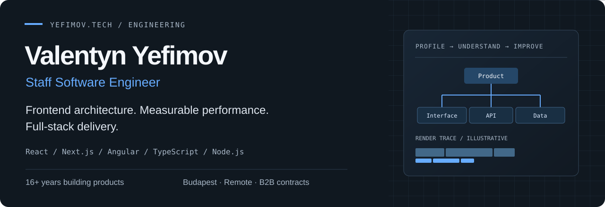

  

  <a href="https://yefimov.tech/">Portfolio</a> ·
  <a href="https://www.linkedin.com/in/valyefimov/">LinkedIn</a> ·
  <a href="https://www.youtube.com/@valyefimov">YouTube</a> ·
  <a href="mailto:val@yefimov.tech">Let's talk</a>

## Building products that stay fast as they grow

I'm **Valentyn**, a Staff Software Engineer based in **Budapest, Hungary**, with **16+ years** in product engineering. I work across frontend architecture, performance and full-stack delivery, and have led teams of up to **10 engineers**.

My work spans healthcare browser extensions, digital insurance, developer tools and AI-assisted workflows. I stay hands-on: architecture decisions, reusable components, backend integrations, profiling and automated testing.

**Open to freelance and B2B contracts, remote work and opportunities in Budapest.**

## Selected engineering work

- **Healthcare MVP → funded product.** Built Platflow's initial Chrome/Edge extension MVP in one week; the company subsequently secured investment. Developed patient-information workflows, authentication and an embedded OpenAI assistant.
- **Insurance platform ownership.** Owned frontend architecture and delivery at Dinghy, including a configurable, rule-based form engine for insurance questionnaires and policy purchasing.
- **Performance with a clear baseline.** At Dev-Pro, reduced the SQL query count for one operation from approximately **1,300 to 25**. At Merly, improved Next.js rendering and data fetching for code views displaying **1,000+ lines**.
- **AI requirements & planning assistant.** Built a private project with **Vercel AI SDK, OpenAI and Anthropic**: configurable prompts, model switching, file uploads and a guided chat workflow generating epics, user stories, tasks and test cases, structured for use in Jira and Trello.

## Open-source projects

| Project | What it does | Explore |
| :--- | :--- | :--- |
| **[react-perf-hooks](https://github.com/valyefimov/react-perf-hooks)** | TypeScript-first React hooks for render diagnostics, performance profiling and web-vitals measurement. | [Documentation & examples](https://valyefimov.github.io/react-perf-hooks/) |
| **[vt-helper](https://github.com/valyefimov/vt-helper)** | Framework-agnostic View Transitions helper with browser fallbacks and multi-step sequencing. | [Interactive examples](https://valyefimov.github.io/vt-helper/) |
| **[TypeKnight](https://github.com/valyefimov/type-knight)** | TypeScript learning game with an in-browser compiler and challenges from type-challenges. | [Play the demo](https://type-knight.yefimov.tech/) |
| **[Comic Grid Studio / Bento Grid](https://github.com/valyefimov/bento-grid)** | Interactive CSS Grid learning through comic layouts, built with SvelteKit and TypeScript. | [Try the demo](https://bento-grid.yefimov.tech/en/) |
| **[chakra-ui3-tour](https://github.com/valyefimov/chakra-ui3-tour)** | Composable onboarding tours for Chakra UI v3, with spotlight overlays and configurable steps. | [Source & usage](https://github.com/valyefimov/chakra-ui3-tour#readme) |
| **[string-best-match](https://github.com/valyefimov/string-best-match)** | Finds the longest shared contiguous sequence between token arrays using rolling hashes and binary search. | [API & examples](https://github.com/valyefimov/string-best-match#readme) |

## Tools I work with

| Area | Core technologies |
| :--- | :--- |
| **Frontend** | TypeScript, JavaScript, React, Next.js, Angular, RxJS, NgRx, Redux Toolkit, Chakra UI, styled-components |
| **Backend & data** | Node.js, NestJS, REST, GraphQL, PostgreSQL, MySQL, MongoDB, Firestore, PHP |
| **Testing** | Playwright, Vitest, Jest, unit, integration and end-to-end testing |
| **AI & extensions** | Vercel AI SDK, OpenAI, Anthropic, Chrome/Edge extensions, Manifest V3, Plasmo |
| **Architecture & delivery** | Performance profiling, SQL optimization, shared libraries, Auth0, SSO, role-based access control, CI/CD, mentoring |

<strong>Additional implementation experience</strong>

I've also implemented backend components in **Go** and a **Ruby proxy layer**. These are supporting skills; my primary expertise is the JavaScript/TypeScript ecosystem.

## Work with me

I can help with frontend architecture, React/Next.js performance, browser extensions, AI integrations and full-stack product delivery.

**[Explore my work](https://yefimov.tech/)** · **[Connect on LinkedIn](https://www.linkedin.com/in/valyefimov/)** · **[Email me](mailto:val@yefimov.tech)**
